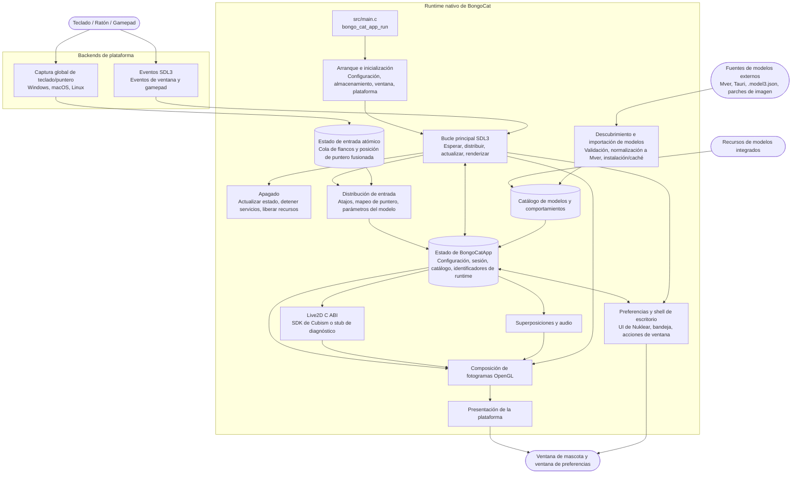

<div align="center">

2.2.2 añade plugins de objetos, sonidos del teclado y tienda de modelos, y mejora la importación en segundo plano y las actualizaciones automáticas. El rebote requiere mantener la mascota en pantalla. La transparencia real de OpenGL en Windows usa alfa por píxel y puede aumentar el coste de lectura de píxeles.
  <a href="https://bongocat.pet" target="_blank">
    
  </a>
  <h1><a href="https://bongocat.pet" target="_blank">BongoCat</a></h1>
</div>

<p align="center">💘 C/C++ × SDL3 × OpenGL, mézclalo todo, ¡a tocar! ¡Bong~ Bongo Cat!!!</p>
<p align="center">
  Elige el idioma ❯ <a href="https://github.com/vladelaina/BongoCat/blob/main/README.md">English</a> • <a href="https://github.com/vladelaina/BongoCat/blob/main/docs/README.zh-CN.md">简体中文</a> • <a href="https://github.com/vladelaina/BongoCat/blob/main/docs/README.zh-Hant.md">繁體中文</a> • <a href="https://github.com/vladelaina/BongoCat/blob/main/docs/README.fr-FR.md">Français</a> • <a href="https://github.com/vladelaina/BongoCat/blob/main/docs/README.de-DE.md">Deutsch</a> • <a href="https://github.com/vladelaina/BongoCat/blob/main/docs/README.ko-KR.md">한국어</a> • <a href="https://github.com/vladelaina/BongoCat/blob/main/docs/README.pt-BR.md">Português</a> • <a href="https://github.com/vladelaina/BongoCat/blob/main/docs/README.ru-RU.md">Русский</a> • <strong>Español</strong> • <a href="https://github.com/vladelaina/BongoCat/blob/main/docs/README.id-ID.md">Bahasa Indonesia</a>
</p>
<p align="center">
  <a href="https://github.com/vladelaina/BongoCat/blob/main/LICENSE"></a>
  <a href="https://github.com/vladelaina/BongoCat"></a>
  <a href="https://discord.gg/vf8jqnattk"></a>
  <a href="https://github.com/vladelaina/BongoCat/blob/main/docs/wechat.png"></a>
  <a href="https://qm.qq.com/q/cYlRBbvuda"></a>
</p>

<div align="center"><video src="https://github.com/user-attachments/assets/75719230-9e49-4124-ae5a-8e35592c5d49" autoplay loop style="border-radius: 8px; max-width: 800px;"></video></div>

> [!TIP]
> El modelo usado en la demo proviene de [宇痕冫](https://space.bilibili.com/348616056).
>
> 🎁 ¿Buscas modelos **gratuitos**? Trabajamos con creadores de modelos talentosos para ofrecerte una gran variedad de modelos gratuitos, ¡mientras seguimos explorando experiencias de escritorio aún más divertidas! Visita nuestro sitio web oficial: [bongocat.pet](https://bongocat.pet/models)

<p align="center">
  <a href="https://bongocat.pet/models">
    
  </a>
</p>

<p align="center"></p>

## 💬 Comunidad de QQ

Escanea el código QR con QQ o busca el grupo **211957388** para unirte a la comunidad de **BongoCat-X**.

<p align="center"></p>

## 📥 Descarga

<a href="https://apps.microsoft.com/detail/9p41mlsx72xw?referrer=appbadge" target="_self"></a>

- GitHub Releases ([v2.2.2](https://github.com/TianMengLucky/BongoCat-X/releases/tag/v2.2.2))

  Descarga la última versión desde [GitHub Releases](https://github.com/TianMengLucky/BongoCat-X/releases/latest).

  > [!IMPORTANT]
  > Las versiones oficiales son **builds runtime-Core**: incluyen soporte de renderizado Live2D, pero **no** incluyen la biblioteca en tiempo de ejecución Live2D Cubism Core (licencia propietaria, nunca se distribuye con los paquetes). **No** son builds de diagnóstico sin Live2D. Si no se encuentra el Core, la aplicación vuelve al backend de diagnóstico y muestra un aviso en la ventana de ajustes.

  **Activar el renderizado Live2D (elige una opción):**

  1. **Importar desde la aplicación (recomendado)**: abre *Ajustes → Plugins*, pulsa *Importar Live2D Core* y selecciona un archivo `Live2DCubismCore.dll` o el zip oficial del SDK de Cubism. Surte efecto de inmediato, sin reiniciar.
  2. **Soltar en la carpeta live2d**: descarga **Cubism SDK for Native** desde la [página oficial de descargas](https://www.live2d.com/en/sdk/download/native/) (acepta la licencia de Live2D) y coloca el zip o el `Live2DCubismCore.dll` extraído en la carpeta `live2d` junto a la aplicación o en el directorio de datos; tras reiniciar se detecta automáticamente.

  Para los pasos completos de importación del SDK al compilar desde el código fuente, consulta la sección «Live2D / Cubism SDK» más abajo.

## 🛠️ Compilar desde el código fuente

BongoCat usa CMake y requiere un compilador C11, un compilador C++17, CMake 3.24 o superior, los archivos de desarrollo de OpenGL para escritorio y la cadena de herramientas de Rust (cargo, por ejemplo mediante rustup): los analizadores críticos para la seguridad de memoria (SHA-256, decodificación de imágenes, el feed de colaboradores y la decodificación de audio) se encuentran en el crate `src/rust/bongo-safe`, que Corrosion compila durante la configuración. Por defecto, SDL3, stb, miniaudio y Nuklear se descargan automáticamente durante la configuración, por lo que la primera configuración requiere conexión a internet.

Ejecuta los siguientes comandos en la raíz del proyecto (el directorio que contiene `CMakeLists.txt`).

### 📋 Requisitos por plataforma

- **Windows:** Visual Studio 2022 (con la carga de trabajo «Desarrollo para escritorio con C++») y CMake. Usa el generador MSVC; MinGW puede compilar el backend de diagnóstico, pero no es compatible con el SDK de Cubism.
- **macOS:** Xcode Command Line Tools, CMake y Ninja. Si la arquitectura de destino difiere de la predeterminada del host, especifícala mediante `CMAKE_OSX_ARCHITECTURES`.
- **Linux (Debian/Ubuntu):** GCC o Clang, Ninja y los encabezados de OpenGL/X11:

  ```bash
  sudo apt-get update
  sudo apt-get install -y build-essential cmake ninja-build \
    libgl1-mesa-dev libx11-dev libxi-dev libxfixes-dev libxcb-screensaver0-dev
  ```

### 🔧 Configuración y compilación

En Linux y macOS, usa un generador de configuración única como Ninja:

```bash
cmake -S . -B build -G Ninja \
  -DCMAKE_BUILD_TYPE=Release \
  -DBONGO_CAT_FETCH_DEPS=ON
cmake --build build --parallel
```

En Windows, ejecuta los comandos desde el Símbolo del sistema para desarrolladores de Visual Studio 2022 (o cualquier shell donde MSVC esté disponible):

```powershell
cmake -S . -B build -G "Visual Studio 17 2022" -A x64 `
  -DBONGO_CAT_FETCH_DEPS=ON
cmake --build build --config Release --parallel
```

El ejecutable se encuentra en `build/BongoCat` en Linux, en `build/BongoCat.app/Contents/MacOS/BongoCat` en macOS y en `build/Release/BongoCat.exe` para las compilaciones de Visual Studio en Windows.

### 🧪 Pruebas

Los objetivos de CTest están habilitados por defecto. Ejecuta lo siguiente después de compilar:

```bash
ctest --test-dir build --output-on-failure
```

Para un generador de múltiples configuraciones como Visual Studio, especifica explícitamente la configuración de compilación:

```powershell
ctest --test-dir build -C Release --output-on-failure
```

### 🎭 Live2D / SDK de Cubism (Opcional: también compila sin él)

El SDK propietario de Cubism sigue siendo opcional. Sin él se compilan la aplicación y el plugin Inox2D. Un plugin Live2D compatible y Cubism Core proporcionado por el usuario permiten activar Live2D sin recompilar la aplicación. Con el SDK se genera el plugin C++ independiente.

1. Abra la [página de descarga del SDK de Cubism](https://www.live2d.com/en/sdk/download/native/), acepte el Live2D Proprietary Software License Agreement y descargue **Cubism SDK for Native** (las versiones se compilan y prueban con el SDK `5-r.5`).
2. Extraiga el archivo. Si la carpeta extraída se llama `CubismSdkForNative-5-r.5`, cámbiele el nombre a `CubismSdkForNative` y colóquela en `vendor/` de modo que el árbol contenga `Core/` y `Framework/`.
3. Los archivos más recientes del SDK ya no incluyen GLEW. Descargue [GLEW 2.2.0](https://github.com/nigels-com/glew/releases/download/glew-2.2.0/glew-2.2.0.zip) y extráigalo en `vendor/CubismSdkForNative/Samples/OpenGL/thirdParty/glew` (el directorio que contiene directamente `include/GL/glew.h` y `src/glew.c`).

También puede guardar el SDK en cualquier ubicación y pasar su ruta explícitamente:

```bash
cmake -S . -B build -G Ninja \
  -DCMAKE_BUILD_TYPE=Release \
  -DBONGO_CAT_CUBISM_SDK=/path/to/CubismSdkForNative
```

El SDK debe incluir la biblioteca Core, el código fuente de Framework y
el directorio de terceros de OpenGL GLEW en la estructura esperada por
`cmake/Cubism.cmake`. Las compilaciones de Cubism en Windows requieren
Visual Studio 2022. Con el SDK ya en su sitio, configure como de
costumbre para obtener una compilación con renderizado de Live2D;
`BONGO_CAT_REQUIRE_CUBISM=ON` solo hace que la configuración falle de
inmediato con instrucciones de importación cuando falta el SDK (la CI
de releases lo usa). Déjelo en el valor predeterminado `OFF` cuando no
lo necesite.

> [!TIP]
> En Windows puede habilitar el renderizado de Live2D sin recompilar: abra
> Ajustes → Modelo en la aplicación, pulse «Importar Live2D Core» y seleccione
> un archivo `Live2DCubismCore.dll` o el zip oficial del SDK de Cubism. El
> cambio surte efecto de inmediato, sin reiniciar.

> [!NOTE]
> Los paquetes oficiales de Release de este repositorio son compilaciones
> runtime-Core: incluyen el renderizador de Live2D, pero **no** incluyen
> el runtime de Core. Al arrancar, la aplicación comprueba la carpeta
> `live2d`: deposite `Live2DCubismCore.dll` o el zip oficial del SDK
> en ella (junto a la aplicación o dentro del directorio de datos)
> y se detectará automáticamente tras un reinicio; también puede
> pulsar «Importar Live2D Core» en Ajustes → Modelo para activarlo de
> inmediato. Cuando no se encuentra ningún Core, la aplicación vuelve
> al backend de diagnóstico y muestra un aviso en la ventana de ajustes.

### ⚙️ Opciones de CMake

| Opción | Valor por defecto | Descripción |
| --- | --- | --- |
| `BONGO_CAT_FETCH_DEPS` | `ON` | Descarga dependencias de terceros en versiones fijadas mediante `FetchContent` de CMake (incluidos Corrosion y las dependencias del crate de Rust). Establécelo en `OFF` solo si SDL3, stb, miniaudio, Nuklear y Corrosion ya están disponibles para CMake. |
| `BONGO_CAT_CUBISM_SDK` | `vendor/CubismSdkForNative` | Ruta del Cubism SDK for Native. |
| `BONGO_CAT_REQUIRE_CUBISM` | `OFF` | Si falta el SDK, la configuración falla. El valor predeterminado es `OFF`: sin el SDK compila el backend de diagnóstico sin renderizado de Live2D; establézcalo en `ON` para exigir el SDK (lo usa la CI de releases). |
| `BONGO_CAT_WARNINGS_AS_ERRORS` | `OFF` | Trata las advertencias del compilador nativo como errores. |

Para una compilación sin conexión, establece `BONGO_CAT_FETCH_DEPS=OFF` y proporciona las configuraciones de paquetes de CMake para SDL3 (incluido `SDL3-static`) ; si stb, Nuklear y miniaudio no se pueden detectar automáticamente, indica también sus directorios de inclusión:

```bash
cmake -S . -B build -G Ninja \
  -DCMAKE_BUILD_TYPE=Release \
  -DBONGO_CAT_FETCH_DEPS=OFF \
  -DBONGO_CAT_STB_INCLUDE_DIR=/path/to/stb \
  -DBONGO_CAT_NUKLEAR_INCLUDE_DIR=/path/to/nuklear \
  -DBONGO_CAT_MINIAUDIO_INCLUDE_DIR=/path/to/miniaudio
```

## 📌 Estado del proyecto


## 📜 Licencia

El código fuente y el runtime nativo de BongoCat están bajo la licencia [AGPL-3.0-only](../LICENSE).

El modo de modelo integrado por defecto (`standard`) permanece bajo la licencia MIT. Los recursos de modelo incluidos en `resources/assets/models/standard`, `keyboard` y `gamepad` están cubiertos por la [declaración de licencia MIT](../LICENSE-MIT) independiente. Esta licencia MIT se aplica únicamente a los recursos de los modelos y sus ilustraciones asociadas; no cambia la licencia del código fuente ni del runtime nativo de BongoCat.

## 🧭 Arquitectura técnica

La versión nativa actual se basa en C/C++, SDL3 y OpenGL. El siguiente diagrama destaca el flujo de datos en tiempo de ejecución; consulta los archivos de CMake para los detalles de compilación y empaquetado.

### 🔄 Propiedad del runtime y planificación de fotogramas

Cada proceso posee una instancia de `BongoCatApp` y un bucle de eventos/renderizado en el hilo principal. Los listeners de plataforma se detienen en el límite de entrada:

```text
Listeners de plataforma (teclado/ puntero)
            |
            v
  Estado de entrada C11 (cola atómica de flancos + posición de puntero fusionada)
            |
            v
  aplicación en el hilo principal <----- eventos SDL3
            |
            v
  parámetros del modelo, superposiciones y estado de la interfaz
            |
            v
  actualización del modelo -> composición OpenGL -> presentación de la plataforma
```

El receptor Raw Input de Windows, el tap de eventos Quartz de macOS y los listeners XInput2 de Linux se ejecutan fuera del bucle principal. Los eventos de teclas y botones entran en una cola atómica acotada; los movimientos se agrupan por separado y los eventos SDL despiertan el hilo principal. Windows recibe entradas en segundo plano mediante una ventana de mensajes con `RIDEV_INPUTSINK | RIDEV_DEVNOTIFY`, conservando los mensajes normales. Cuando otra aplicación oculta o bloquea el cursor, el modelo usa los movimientos del dispositivo; SDL proporciona la posición del cursor en el escritorio. Los estados pulsados se limpian al desconectar un dispositivo o cambiar el escritorio de entrada. Windows ya no usa hooks de entrada ni DirectInput. Los eventos de ventana, preferencias y gamepad de SDL3 se procesan en el hilo principal. Ningún listener de plataforma llama directamente al código de Live2D, superposiciones o interfaz.

`bongo_cat_app_run` gestiona los parámetros de actualización, cierre y procesos secundarios, hace cumplir la propiedad de una única instancia del proceso principal, asigna el estado de la aplicación, realiza la inicialización, entra en `bongo_cat_app_loop` y luego actualiza el estado y libera los recursos en el orden definido. La inicialización carga la configuración y las rutas de almacenamiento, localiza los recursos, crea la ventana de mascota SDL/OpenGL, inicializa los backends de plataforma, crea los servicios de Live2D/superposiciones/audio, escanea las fuentes de modelos integrados/instalados/cercanos y carga los modelos disponibles. `BongoCatApp` conserva la configuración, el estado de la sesión, los catálogos de modelos y comportamientos, los identificadores de plataforma y los identificadores de servicios en tiempo de ejecución.

Los paquetes de modelos instalados usan Mver como formato canónico. El proceso de importación analiza el archivo o directorio seleccionado, descubre y valida los candidatos, genera una huella de identidad del paquete, convierte las fuentes Tauri a Mver, aplica parches de imagen y envía el paquete normalizado a `models_root`. Después se generan los adaptadores de tiempo de ejecución y se actualiza el catálogo. Las fuentes cercanas solo se descubren sin instalar su árbol de origen; sus adaptadores y resultados de comprobación se almacenan en caché bajo `cache_root`, fuera de `models_root`.

Cada iteración del bucle principal espera activaciones SDL/nativas o el vencimiento más temprano de los plazos de fotograma, interfaz, animación y acierto de puntero (máximo 250 ms). El bucle distribuye los eventos SDL en cola, vacía la cola de entrada atómica y realiza la recuperación de liberaciones, actualiza el estado de la ventana y de actualización del modelo y luego aplica los parámetros de entrada. Con Cubism habilitado, el plazo del modelo sigue `settings.model.max_fps` (predeterminado 60 FPS); las compilaciones de diagnóstico usan un intervalo de reserva de 100 ms. El tiempo transcurrido del modelo se cuenta como máximo 250 ms y se divide en hasta ocho subpasos, cada uno con un objetivo de no más de 1/30 de segundo.

La ruta normal de la mascota solo se renderiza cuando la ventana es visible, no está minimizada y está marcada como sucia. Cada fotograma primero limpia el fondo, dibuja el modelo y luego compone las superposiciones de puntero, teclas y efectos, y finalmente llama al presentador de la plataforma. Las operaciones de vista previa pueden solicitar renderizado inmediato; el renderizado de capturas de pantalla puede omitir la presentación. macOS y Linux intercambian directamente la ventana SDL OpenGL; Windows la intercambia directamente cuando la presentación en capas no está habilitada; de lo contrario, lee el búfer de fotogramas y llama a `UpdateLayeredWindow`. La interfaz de preferencias tiene su propia ventana SDL/OpenGL y se renderiza y presenta por separado.

El runtime C llama a la ABI declarada en `include/bongo_cat/model.h`. El puente Live2D y la implementación de Cubism están en `src/live2d` y solo usan C++17 cuando el SDK de Cubism está habilitado; el resto del runtime nativo usa C11. Los tipos de Cubism se mantienen detrás de identificadores C opacos; cuando el SDK no está disponible, `src/live2d/live2d_stub.c` proporciona el backend de diagnóstico.



## ❓ Preguntas frecuentes

### 🔒 ¿BongoCat registra mis entradas de teclado o ratón?

No. BongoCat procesa las entradas de teclado y ratón localmente para impulsar animaciones y atajos. No registra ni sube pulsaciones de teclas, acciones del ratón ni otros datos de interacción. La configuración también se guarda solo localmente; la aplicación no incluye anuncios, herramientas de análisis ni código de seguimiento de usuarios. Al comprobar actualizaciones solo se solicitan los metadatos públicos de versión; no se envían datos de entrada, configuración ni uso.

### 🖼️ ¿Cuál es el estado del soporte de Vulkan / Metal?

Ajustes → Aplicación → Backend de renderizado permite cambiar al instante: OpenGL ↔ Vulkan en Windows / Linux x64 y OpenGL ↔ Metal en macOS. Sistema usa OpenGL por defecto. Se conectaron la carga de texturas nativas, el dibujo de Cubism, la lectura de GPU y la recarga del modelo; se conservan el modelo y los movimientos/expresiones seleccionados. Los errores de inicialización o recarga restauran OpenGL. Vulkan/Metal son experimentales: las capas de teclas/efectos/puntero ya admiten todos los motores. Live2D admite resolución dinámica en OpenGL, Vulkan y Metal, con decodificación y escalado en segundo plano y carga nativa a la GPU síncrona. Desactivarla recarga las texturas según la calidad elegida. Los backends nativos almacenan el fondo de mesa en caché, lo incluyen en los límites del marco ajustado y redondean las cuatro esquinas en la GPU sin otra textura de pantalla completa. Las capas usan el renderizado por software de SDL, se almacenan hasta que cambie la entrada y se combinan con el cuadro nativo terminado antes de enviarlo a la GPU; el rendimiento sigue sin medir.

La optimización de renderizado aparece en Vulkan / Metal y está desactivada por defecto. Vulkan ofrece tres opciones; Metal solo grandes asignaciones. Inox2D Metal agrupa los vértices de cada fotograma; Live2D Metal muestra esta opción como no disponible. Sus tres subopciones se guardan por separado; los cambios recargan el modelo. Inox2D Vulkan admite grabación paralela y bloques grandes. Live2D Vulkan admite VMA y grabación paralela con mezcla normal, sin nodos fuera de pantalla ni máscaras de alta precisión. Live2D requiere 128 Drawables para búferes secundarios y 128 instantáneas dibujables para usar hasta cuatro hilos; los demás modelos conservan la ruta serial del SDK. Live2D Vulkan Bindless usa una tabla de hasta 64 texturas de atlas con mezcla normal y sin nodos fuera de pantalla; vuelve a la ruta anterior si faltan capacidades del dispositivo. Inox2D Bindless no está implementado. Los pools grandes pueden usar más memoria; las mejoras de rendimiento aún no se han medido.

Las compilaciones con SDK usan `BONGO_CAT_CUBISM_VULKAN=ON` en Windows / Linux x64 (`glslangValidator` o `glslang`, paquete Linux `glslang-tools`; Vulkan 1.3 al ejecutar) y `BONGO_CAT_CUBISM_METAL=ON` en macOS (herramientas Metal de Xcode). Use `OFF` para desactivar la extensión. Los archivos Metal y `.metallib` se incluyen solo en macOS; Vulkan y `.spv` solo en Windows / Linux x64, con variantes de mezcla. Las compilaciones de diagnóstico sin SDK omiten estos recursos Live2D. GitHub Actions prepara las herramientas y verifica los recursos por plataforma. Se realizaron comprobaciones estáticas; falta validar compilación y GPU. Véase [integración y validación](live2d-vulkan-metal.md).

## 🙏 Agradecimientos especiales
> [!TIP]
> Cada paso de BongoCat está impulsado por el espíritu del código abierto. Agradecemos sinceramente a todos los colaboradores de la comunidad por sus contribuciones desinteresadas (listadas a continuación en orden cronológico). Es vuestro apoyo lo que hace que la compañía en el escritorio sea más libre y genuina.❤️‍🔥


<a href="https://bongocat.pet">
    
</a>


[linux.do](https://linux.do/t/topic/2845597)
---

<div align="center">
Derechos de autor © 2026 - **BongoCat**<br>
By vladelaina<br>
Made with ❤️ & ⌨️
</div>

### Diseño de las opciones

Las preferencias usan un único diseño de tarjetas agrupadas. Ventana, Modelo, Aplicación y Apariencia se muestran expandidos por defecto. Pulsa el título para plegar o desplegar sus opciones. No hay selector de estilo y los valores existentes se conservan.

### Complemento de estadísticas de entrada

El complemento Rust se compila con la aplicación por defecto. Actívalo, desactívalo o impórtalo en la página de complementos. La página de estadísticas muestra totales de teclado y ratón, gráficos diarios y por hora, almacenamiento local y exportación CSV. Consulta [Estadísticas](statistics-plugin.md). El tiempo de la aplicación activa incluye clasificación, totales por hora y un control independiente. La captura, el almacenamiento y la exportación usan un hilo independiente. El complemento registra la entrada de estadísticas al activarse y la elimina al desactivarse o desinstalarse.

### Plugins de renderizado dinámicos

Preferencias → Plugins permite instalar, activar y eliminar renderizadores locales. Cambia a otro renderizador antes de modificar un plugin activo. Live2D utiliza un plugin C++; Inochi2D utiliza el plugin Rust Inox2D con OpenGL, Vulkan (Windows/Linux) y Metal (macOS), sin wgpu. La importación identifica primero el contenido del modelo (`.model3.json`, `.inp`, `.inx`). Todo el análisis y la escritura de JSON se realiza en Rust.

Las versiones portátiles de Windows se distribuyen como archivos ZIP. Mantén la carpeta extraída `plugins` junto al ejecutable. Consulta [Plugins de renderizado](model-plugins.md) para los paquetes, las dependencias sin conexión, la ABI, la asignación de parámetros y los límites de compatibilidad.

Cada push a `dev` que cambia código, recursos o configuración de compilación publica una versión preliminar nocturna en GitHub. Se omiten los cambios solo de documentación; no hay ejecución programada. Todas las plataformas usan el commit enviado. Estas versiones no reemplazan la última versión estable.

Las versiones nocturnas reutilizan la [página nightly](https://github.com/TianMengLucky/BongoCat-X/releases/tag/nightly), actualizan la etiqueta y reemplazan archivos con nombres fijos. Si falla una plataforma, conserva sus archivos anteriores.

### Linux Wayland / evdev

La entrada evdev experimental en Linux Wayland se activa con `BONGOCAT_ENABLE_EVDEV=1`. Primero se intenta abrir los dispositivos como usuario normal, en modo de solo lectura. Si faltan permisos, una instalación protegida solicita autenticación mediante `/usr/bin/sudo`, abre los dispositivos y reinicia tras abandonar inmediatamente los privilegios, antes de inicializar SDL, ajustes y modelos. El programa, sudo y sus directorios superiores deben pertenecer a root y no permitir escritura al grupo ni a otros usuarios. Las instalaciones de desarrollo y portátiles necesitan permisos administrados por separado. La ruta de sudo se configura con `BONGO_CAT_SUDO_EXECUTABLE`. Un fallo detiene el inicio; no se cambian permisos permanentes. Solo se vigilan los dispositivos presentes al inicio; conectar nuevos requiere reiniciar. No ejecutar directamente como root ni unirse al grupo `input`. La entrada puede incluir contraseñas y no se pausa al bloquear, cambiar de sesión u ocultar la mascota.

[SECURITY.md](../SECURITY.md#linux-input)

Preferencias → Preferencias → Ventana permite elegir una imagen de fondo personalizada: PNG, JPEG, WebP, BMP o GIF (primer fotograma). La imagen llena la ventana centrada, conservando sus proporciones, y es incompatible con el fondo de color sólido. Se guarda en el directorio de datos de la aplicación, por lo que mover el original no afecta al fondo. Máximo: 64 MB y 16 megapíxeles. Compatible con OpenGL, Vulkan y Metal.

Live2D reutiliza automáticamente los búferes de geometría y estados de renderizado repetidos. Las cargas dinámicas de OpenGL, los lotes y la caché de Vulkan, los búferes compartidos de Metal y las máscaras nativas adaptativas no requieren otro interruptor. El rendimiento y el comportamiento por plataforma están pendientes de medición.

Ajustes → Aplicación → Modo de memoria reducida está desactivado por defecto. Limita la calidad al 10%, los lados de texturas a 512 píxeles y las máscaras Live2D a 256, suspende grandes optimizaciones y recarga el renderizador. Desactivar restaura la calidad guardada. 50MB es un objetivo; depende del modelo y controlador.

Ajustes → Mascota → Rango de seguimiento: horizontal/vertical 25–400%, desactivado por defecto; 100% conserva el rango. Las patas Mver dibujadas pueden moverse más; Live2D mantiene sus límites. Mirada y ventana no cambian. El modo de memoria reducida desactiva MSAA y reduce shaders y pipelines sin uso.

En Windows, los ajustes de memoria reducida usan renderizado SDL por software en bloques y fondo opaco con OpenGL/Vulkan. Se conservan el tamaño real, DPI y antialiasing de las fuentes. El atlas almacena máscaras A8 y convierte solo el glifo dibujado. OpenGL en otras plataformas sigue reutilizando el contexto de la mascota.
### Varias teclas y caracteres legibles en modo espejo

Mver (OpenGL/Vulkan/Metal) recorta por separado la mano, el marco y los caracteres, uniendo las teclas pulsadas con + en un solo bocadillo. El marco y la cola se reflejan con el modelo; los caracteres siguen siendo legibles, también en modo de una tecla. Configura las tres áreas, el espacio alrededor de + y el límite por lado en `hand-layout.json` junto a las imágenes de las manos; reinicia tras editar. Consulta la [guía y el ejemplo](hand-layout.md).

El diálogo de acciones comprueba la referencia `Sound` y si existe el archivo, y muestra un control de volumen junto a los movimientos con audio. Ajusta entre 0 y 100% arrastrando o escribiendo; el doble clic restaura el 100% y el 0% silencia. Los valores se guardan por modelo y movimiento y se aplican al diálogo, atajos, movimientos aleatorios y menú contextual, también durante la reproducción. Otros movimientos que usan el mismo archivo conservan su propio volumen.

### Plugin de objetos

El plugin independiente de objetos se incluye por defecto. Actívalo en Preferencias → Plugins para mostrar Objetos. Admite importación de varias imágenes y arrastrar y soltar, posición, tamaño, rotación, opacidad, capas delanteras/traseras, bloqueo, duplicados y guardado de escenas con OpenGL, Vulkan y Metal. Seguir el área del modelo no fija el objeto a la malla. GIF muestra el primer fotograma; hasta 16 objetos en la mascota principal. Consulta [Plugin de objetos](items-plugin.md). `BONGO_CAT_BUILD_ITEMS=OFF` omite la biblioteca.

Preferencia de memoria de renderizado: Priorizar memoria de vídeo / Priorizar memoria del sistema. Solo Live2D Vulkan. Recarga el renderizado. La memoria de vídeo favorece la velocidad; la del sistema reduce la presión sobre la VRAM, pero puede ser más lenta. Los recursos no compatibles usan una alternativa automática. Otros motores asignan automáticamente; las GPU integradas comparten memoria.

### Sonidos del teclado

Activa Efectos de sonido en Plugins. Haz clic en una tecla para elegir audio, pasa el cursor para ver el nombre y pulsa la tecla física para reproducirlo. Las asignaciones se guardan automáticamente. Sonidos y objetos tienen hilos separados. WAV/MP3/Ogg Vorbis/FLAC en la mascota principal. Consulta [Efectos de sonido](sounds-plugin.md); `BONGO_CAT_BUILD_SOUNDS=OFF` omite la biblioteca.

La tienda Rust ofrece vistas previas, enlaces de autor y botones de descarga/desinstalación. SHA-256 se verifica antes de instalar; se muestra un estado pendiente si el catálogo no está publicado. [Complemento de tienda](store-plugin.md).

La búsqueda automática de actualizaciones está activada por defecto en Preferencias → Aplicación y se ejecuta una vez en segundo plano en cada inicio. El aviso de una nueva versión se conserva hasta abrir Ajustes y ofrece «Actualizar ahora» arriba a la derecha. Todos los avisos de Ajustes se pueden cerrar manualmente.

La página de modelos agrupa los modos del mismo paquete en una tarjeta con selector, incluidos los modos estándar, teclado y mando predeterminados. Puede arrastrar varios ZIP para importarlos en segundo plano. Cerrar Ajustes no interrumpe la importación. Al salir se detienen las importaciones pendientes y se espera a que termine la fuente actual antes de liberar los hilos y recursos temporales.

Los atajos están dentro de Preferencias, con el selector Ajustes / Atajos. La tienda está dentro de Modelo, con Modelos locales / Tienda. Se eliminan sus dos entradas independientes de la barra lateral; cada subpágina conserva su posición de desplazamiento.

Al activar Live2D sin Cubism Core se muestran ambos acuerdos oficiales. En Windows, Aceptar y descargar obtiene el SDK Native R5 por HTTPS oficial, extrae solo el Core dinámico compatible y activa el renderizado local. Cancelar y continuar mantiene el complemento activado sin renderizado. Se puede reintentar o importar manualmente. La aplicación y los paquetes no incluyen SDK ni Core.
