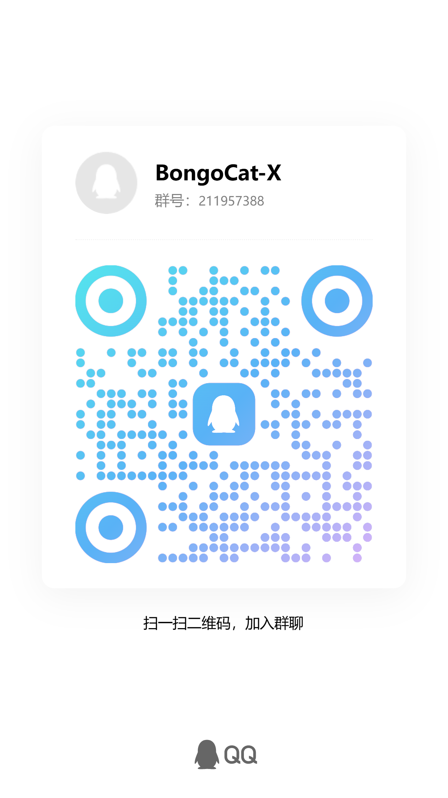

<div align="center">

2.2.3: 오른쪽 클릭 원형 메뉴 설정, 최대화/복원을 지원하는 더 큰 설정 창, 색상별 초기화, 통계 단위 편집 및 반올림 개선.
  <a href="https://bongocat.pet" target="_blank">
    
  </a>
  <h1><a href="https://bongocat.pet" target="_blank">BongoCat</a></h1>
</div>

<p align="center">💘 C/C++ × Rust × SDL3，함께 섞어서 마음껏 두드리세요! Bong~ Bongo Cat!!!</p>
<p align="center">
  <a href="README.en-US.md">English</a> • <a href="../README.md">简体中文</a> • <a href="README.zh-Hant.md">繁體中文</a> • <a href="README.fr-FR.md">Français</a> • <a href="README.de-DE.md">Deutsch</a> • <strong>한국어</strong> • <a href="README.pt-BR.md">Português</a> • <a href="README.ru-RU.md">Русский</a> • <a href="README.es-ES.md">Español</a> • <a href="README.id-ID.md">Bahasa Indonesia</a>
</p>
> [!NOTE]
> 이 저장소(**BongoCat-X**)는 [vladelaina/BongoCat](https://github.com/vladelaina/BongoCat)의 포크입니다. Live2D Inc.와 관계가 없으며 Cubism SDK나 Core를 포함하지 않습니다. Live2D 라이선스를 준수해야 합니다.

<p align="center">
  <a href="../LICENSE"></a>
  <a href="https://github.com/TianMengLucky/BongoCat-X"></a>
</p>

<div align="center"><video src="https://github.com/user-attachments/assets/75719230-9e49-4124-ae5a-8e35592c5d49" autoplay loop style="border-radius: 8px; max-width: 800px;"></video></div>

> [!TIP]
> 데모에 사용된 모델은 [宇痕冫](https://space.bilibili.com/348616056)님의 작품입니다.
>
> 🎁 **무료** 모델을 찾으시나요? 저희는 재능 있는 모델 크리에이터들과 협력하여 다양한 무료 모델을 제공하고, 더 재미있는 데스크톱 경험도 끊임없이 탐색하고 있습니다! 공식 웹사이트를 방문하세요: [bongocat.pet](https://bongocat.pet/models)

<p align="center">
  <a href="https://bongocat.pet/models">
    
  </a>
</p>

## 💬 QQ 커뮤니티

QQ로 QR 코드를 스캔하거나 그룹 번호 **211957388**을 검색하여 **BongoCat-X** 커뮤니티에 참여하세요.

<p align="center"></p>

## Live2D SDK 및 색상 설정

SDK 가져오기와 다운로드는 설정 → 플러그인에서 관리하며 모델 페이지는 모델을 관리합니다. Windows에서 Live2D 플러그인을 활성화하고 Live2D SDK 다운로드를 선택한 뒤 두 공식 약관을 읽고 동의하면 호환 Core를 다운로드하여 설치합니다. 받은 용량, 전체 크기와 백분율이 표시되며 실패 시 대화상자에서 재시도할 수 있습니다. 다른 플랫폼에서는 호환 Core를 수동으로 가져오세요. 외관과 단색 배경은 색상 견본을 클릭하여 여는 팔레트 팝업을 공유합니다.

## 📥 다운로드

- GitHub Releases ([v2.2.3](https://github.com/TianMengLucky/BongoCat-X/releases/tag/v2.2.3))

  [GitHub Releases](https://github.com/TianMengLucky/BongoCat-X/releases/latest)에서 최신 버전을 다운로드하세요.

  > [!IMPORTANT]
  > 공식 릴리스는 **runtime-Core 빌드**입니다: Live2D 렌더링 지원이 내장되어 있지만, Live2D Cubism Core 런타임 라이브러리는 **포함되지 않습니다**(독점 라이선스로 패키지에 절대 포함되지 않음). Live2D 없는 진단 빌드가 **아닙니다**. Core를 찾지 못하면 진단 백엔드로 전환되고 설정 창에 안내가 표시됩니다.

  **Live2D 렌더링 활성화 (둘 중 하나 선택):**

  1. **앱 내 가져오기 (권장)**: *설정 → 플러그인* 페이지를 열고 *Live2D Core 가져오기*를 클릭한 뒤 `Live2DCubismCore.dll` 또는 공식 Cubism SDK zip 파일을 선택하세요. 재시작 없이 즉시 적용됩니다.
  2. **live2d 폴더에 넣기**: [공식 다운로드 페이지](https://www.live2d.com/en/sdk/download/native/)에서(Live2D 라이선스에 동의 필요) **Cubism SDK for Native**를 다운로드하여 zip 또는 압축을 푼 `Live2DCubismCore.dll`을 앱 옆 또는 데이터 디렉터리의 `live2d` 폴더에 넣고 앱을 재시작하면 자동으로 인식됩니다.

  소스에서 빌드할 때의 전체 SDK 가져오기 절차는 아래 «Live2D / Cubism SDK» 섹션을 참고하세요.

## 🛠️ 소스 코드로 빌드하기

BongoCat에는 CMake 3.24 이상, C11 및 C++17 컴파일러, 데스크톱 OpenGL 개발 파일과 Rust 도구 체인(rustup으로 설치하는 cargo)이 필요합니다. Corrosion이 Rust 모듈을 빌드합니다. 구성 단계에서 기본적으로 SDL3, stb, miniaudio, Nuklear와 Corrosion을 다운로드하므로 첫 빌드에는 네트워크 연결이 필요합니다.

프로젝트 루트 디렉토리(`CMakeLists.txt`가 있는 디렉토리)에서 다음 명령어를 실행하세요.

### 📋 플랫폼 사전 요구 사항

- **Windows:** Visual Studio 2022("C++를 사용한 데스크톱 개발" 워크로드 설치) 및 CMake. MSVC 생성기를 사용하세요. MinGW는 진단 백엔드를 빌드할 수 있지만 Cubism SDK를 지원하지 않습니다.
- **macOS:** Xcode Command Line Tools, CMake 및 Ninja. 대상 아키텍처가 호스트 기본 아키텍처와 다른 경우 `CMAKE_OSX_ARCHITECTURES`를 통해 지정하세요.
- **Linux(Debian/Ubuntu):** GCC 또는 Clang, Ninja, OpenGL/X11 헤더 파일:

  ```bash
  sudo apt-get update
  sudo apt-get install -y build-essential cmake ninja-build \
    libgl1-mesa-dev libx11-dev libxi-dev libxfixes-dev libxcb-screensaver0-dev libfontconfig1-dev fonts-noto-cjk
  ```

### 🔧 구성 및 빌드

Linux 및 macOS에서는 Ninja와 같은 단일 구성 생성기를 사용하세요:

```bash
cmake -S . -B build -G Ninja \
  -DCMAKE_BUILD_TYPE=Release \
  -DBONGO_CAT_FETCH_DEPS=ON
cmake --build build --parallel
```

Windows에서는 Visual Studio 2022 개발자 명령 프롬프트(또는 MSVC를 사용할 수 있는 기타 명령줄)에서 다음을 실행하세요:

```powershell
cmake -S . -B build -G "Visual Studio 17 2022" -A x64 `
  -DBONGO_CAT_FETCH_DEPS=ON
cmake --build build --config Release --parallel
```

실행 파일 위치: Linux `build/BongoCat`, macOS `build/BongoCat.app/Contents/MacOS/BongoCat`, Visual Studio 빌드 Windows 버전 `build/Release/BongoCat.exe`.

### 🧪 테스트

일반 빌드의 작업량을 줄이기 위해 테스트 대상은 기본적으로 꺼져 있습니다. 필요할 때 활성화하고 빌드하세요:

```bash
cmake -S . -B build -DBUILD_TESTING=ON
cmake --build build --parallel
ctest --test-dir build --output-on-failure
```

Visual Studio와 같은 다중 구성 생성기의 경우 빌드 구성을 명시적으로 지정하세요:

```powershell
cmake -S . -B build -DBUILD_TESTING=ON
cmake --build build --config Release --parallel
ctest --test-dir build -C Release --output-on-failure
```

### 🎭 Live2D / Cubism SDK (선택 사항 — 설치하지 않아도 빌드 가능)

독점 Cubism SDK는 선택 사항입니다. SDK 없이도 호스트와 Inox2D 플러그인을 빌드할 수 있습니다. 호환 Live2D 플러그인과 별도로 제공한 Cubism Core를 설치하면 호스트를 다시 빌드하지 않고 Live2D를 활성화할 수 있습니다. SDK가 있으면 별도 C++ 플러그인이 생성됩니다.

1. [Cubism SDK 다운로드 페이지](https://www.live2d.com/en/sdk/download/native/)에 접속하여 Live2D 전용 소프트웨어 라이선스 계약에 동의한 뒤 **Cubism SDK for Native**를 다운로드합니다(릴리스는 `5-r.5` SDK 기준으로 빌드 및 테스트됩니다).
2. 압축을 풉니다. 풀린 폴더 이름이 `CubismSdkForNative-5-r.5`라면 `CubismSdkForNative`로 이름을 바꾸고 `vendor/` 아래에 두어 `Core/`와 `Framework/`가 포함되도록 합니다.
3. 최신 SDK 아카이브에는 GLEW가 포함되어 있지 않습니다. [GLEW 2.2.0](https://github.com/nigels-com/glew/releases/download/glew-2.2.0/glew-2.2.0.zip)을 다운로드하여 `vendor/CubismSdkForNative/Samples/OpenGL/thirdParty/glew`(`include/GL/glew.h`와 `src/glew.c`가 바로 들어 있는 디렉터리)에 풀어 주세요.

SDK를 임의의 위치에 두고 그 경로를 명시적으로 지정할 수도 있습니다:

```bash
cmake -S . -B build -G Ninja \
  -DCMAKE_BUILD_TYPE=Release \
  -DBONGO_CAT_CUBISM_SDK=/path/to/CubismSdkForNative
```

SDK에는 Core 라이브러리, Framework 소스 코드, 그리고 `cmake/Cubism.cmake`가 요구하는 레이아웃의 OpenGL GLEW 서드파티 디렉터리가 포함되어야 합니다. Windows Cubism 빌드에는 Visual Studio 2022가 필요합니다. SDK를 제자리에 두면 평소처럼 구성하기만 하면 Live2D 렌더링이 포함된 빌드를 얻을 수 있습니다. `BONGO_CAT_REQUIRE_CUBISM=ON`은 SDK가 없을 때 구성이 가져오기 안내와 함께 즉시 실패하도록 할 뿐입니다(릴리스 CI에서 사용합니다). 해당 동작이 필요하지 않다면 기본값인 `OFF`로 두세요.

### ⚙️ CMake 옵션

| 옵션 | 기본값 | 설명 |
| --- | --- | --- |
| `BONGO_CAT_FETCH_DEPS` | `ON` | CMake `FetchContent`를 사용하여 고정 버전의 서드파티 종속성을 다운로드합니다(Corrosion 및 Rust crate 종속성 포함). SDL3, stb, miniaudio, Nuklear 및 Corrosion을 CMake에서 이미 사용할 수 있는 경우에만 `OFF`로 설정하세요. |
| `BONGO_CAT_CUBISM_SDK` | `vendor/CubismSdkForNative` | Cubism SDK for Native의 경로입니다. |
| `BONGO_CAT_REQUIRE_CUBISM` | `OFF` | SDK가 없을 때 구성을 실패하게 할지 여부입니다. 기본값 `OFF`: SDK가 없으면 Live2D 렌더링이 없는 진단 백엔드를 빌드합니다. SDK를 필수로 요구하려면 `ON`으로 설정하세요(릴리스 CI에서 사용합니다). |
| `BONGO_CAT_WARNINGS_AS_ERRORS` | `OFF` | 로컬 컴파일러 경고를 오류로 처리합니다. |

오프라인 빌드 시 `BONGO_CAT_FETCH_DEPS=OFF`로 설정하고, SDL3(`SDL3-static` 포함) 의 CMake 패키지 구성을 제공하세요. stb, Nuklear 및 miniaudio를 자동으로 찾을 수 없는 경우 해당 include 디렉토리도 제공해야 합니다:

```bash
cmake -S . -B build -G Ninja \
  -DCMAKE_BUILD_TYPE=Release \
  -DBONGO_CAT_FETCH_DEPS=OFF \
  -DBONGO_CAT_STB_INCLUDE_DIR=/path/to/stb \
  -DBONGO_CAT_NUKLEAR_INCLUDE_DIR=/path/to/nuklear \
  -DBONGO_CAT_MINIAUDIO_INCLUDE_DIR=/path/to/miniaudio
```

## 📌 프로젝트 상태


## 📜 라이선스

BongoCat 소스 코드 및 로컬 런타임은 [AGPL-3.0-only](../LICENSE) 라이선스를 따릅니다.

기본 내장 모델(`standard`)은 여전히 MIT 라이선스를 따릅니다. `resources/assets/models/standard`, `keyboard` 및 `gamepad`에 번들로 제공되는 모델 리소스는 별도의 [MIT 라이선스 고지](../LICENSE-MIT)가 적용됩니다. 해당 MIT 라이선스는 모델 리소스 및 관련 아트워크에만 적용되며, BongoCat 소스 코드나 로컬 런타임의 라이선스를 변경하지 않습니다.

## 🧭 기술 아키텍처

C11 호스트는 SDL3로 메인 스레드 이벤트, 모델 업데이트와 화면 표시를 관리하고 설정에는 Nuklear를 사용합니다. `src/rust/bongo-safe`는 신뢰할 수 없는 데이터 파싱, 입력 큐와 지표, 공통 플러그인 작업 스레드 상태를 관리합니다. Live2D 브리지, Vulkan 리소스 백엔드와 Windows COM/WIC 어댑터는 C++17을 사용합니다.

플랫폼 리스너는 키와 마우스 버튼 이벤트를 유계 Rust 큐에 전달하고 포인터 이동을 별도로 합친 뒤 메인 스레드를 깨워 모델 매개변수와 UI를 갱신합니다. 버전이 있는 C ABI로 Live2D/Inox2D 플러그인을 로드하며 플랫폼에 따라 OpenGL, Vulkan 또는 Metal을 사용합니다.

호환성과 빌드는 [렌더러 플러그인](model-plugins.md), 백엔드 제한과 검증 범위는 [네이티브 렌더링](live2d-vulkan-metal.md)을 참고하세요.

## ❓ 자주 묻는 질문

### 🔒 BongoCat이 제 키보드나 마우스 입력을 기록하나요?

BongoCat은 애니메이션과 단축키를 위해 입력을 로컬에서 처리하며 입력이나 사용 데이터를 업로드하지 않습니다. 통계 플러그인을 켜면 합계, 일별·시간별 추세와 활성 앱 사용 시간을 로컬에 저장할 수 있습니다. 입력한 텍스트, 키 순서, 창 제목, URL이나 좌표는 저장하지 않습니다. 통계 페이지에서 수집을 끄거나 기록을 초기화·내보낼 수 있습니다. [통계 플러그인](statistics-plugin.md)을 참고하세요. 업데이트는 공개 릴리스 메타데이터를 요청합니다.

### 🖼️ Vulkan / Metal 지원은 어디까지 진행되었나요?

설정 → 앱 → 렌더 백엔드에서 재시작 없이 전환합니다. Windows / Linux x64는 OpenGL ↔ Vulkan, macOS는 OpenGL ↔ Metal을 지원하며 시스템 기본값은 OpenGL입니다. 네이티브 텍스처 업로드, Cubism 그리기, GPU 읽기와 모델 재로딩을 연결했습니다. 모델과 선택한 동작/표정을 보존하며 초기화나 로딩 실패 시 OpenGL로 복원합니다. Vulkan/Metal은 실험적입니다. 키/효과/포인터 오버레이는 이제 모든 백엔드를 지원합니다. Live2D는 OpenGL, Vulkan, Metal에서 동적 텍스처 해상도를 지원하며 백그라운드 디코딩/크기 조절과 동기 네이티브 GPU 업로드를 사용합니다. 비활성화하면 선택한 화질에 맞춰 텍스처를 다시 로드합니다. 네이티브 백엔드는 책상 배경을 캐시하고 밀착 프레임 경계에 포함하며, 추가 전체 화면 텍스처 없이 GPU에서 네 모서리를 둥글게 처리합니다. 오버레이는 SDL 소프트웨어 렌더링을 사용하고 입력이 바뀔 때까지 캐시하며, 완성된 네이티브 프레임에 합성한 뒤 GPU에 다시 업로드합니다. 성능은 아직 측정하지 않았습니다.

대규모 렌더링 최적화는 Vulkan / Metal에서 표시되며 기본적으로 꺼져 있습니다. Vulkan은 세 옵션, Metal은 대용량 메모리 할당만 제공합니다. Inox2D Metal은 프레임 정점을 공유 버퍼로 합치며 Live2D Metal에서는 사용할 수 없습니다. 세 하위 옵션은 개별 저장되며 변경 시 모델을 다시 로드합니다. Inox2D Vulkan은 병렬 명령 기록과 대용량 메모리 블록을 지원합니다. Live2D Vulkan은 VMA와 일반 혼합 모델의 병렬 기록을 지원하며 오프스크린 노드와 고정밀 마스크는 제외됩니다. Live2D는 Drawable 128개 이상에서 보조 버퍼를 사용하고 그릴 수 있는 스냅샷 128개 이상에서 최대 4개 작업 스레드를 사용합니다. 다른 모델은 SDK 직렬 경로를 유지합니다. Live2D Vulkan Bindless는 일반 혼합 및 오프스크린 노드가 없는 모델에서 최대 64개 아틀라스 텍스처 테이블을 사용하며 장치 기능이나 용량이 부족하면 기존 경로로 돌아갑니다. Inox2D Bindless는 아직 구현되지 않았습니다. 큰 풀은 메모리를 더 사용할 수 있으며 성능 향상은 아직 측정하지 않았습니다.

SDK 빌드는 Windows / Linux x64에서 `BONGO_CAT_CUBISM_VULKAN=ON`을 사용합니다(`glslangValidator` 또는 `glslang`, Linux 패키지 `glslang-tools`; 실행 시 Vulkan 1.3 필요). macOS는 `BONGO_CAT_CUBISM_METAL=ON`과 Xcode Metal 도구를 사용합니다. `OFF`로 해당 확장을 제외할 수 있습니다. Metal 소스와 `.metallib`는 macOS에만, Vulkan 소스와 `.spv`는 Windows / Linux x64에만 혼합 모드 변형과 함께 포함됩니다. SDK 없는 진단 빌드는 이 Live2D 리소스를 제외합니다. GitHub Actions는 플랫폼별 도구를 준비하고 리소스를 확인합니다. 정적 검사를 수행했지만 빌드와 GPU 동작은 아직 검증하지 않았습니다. [통합 현황과 검증](live2d-vulkan-metal.md)을 참조하세요.

## 🙏 특별 감사
> [!TIP]
> BongoCat의 모든 걸음은 오픈 소스 정신으로 이루어집니다. 커뮤니티 기여자분들의 사심 없는 기여에 진심으로 감사드립니다(기여 날짜순 정렬). 여러분의 지원이 데스크톱 동반을 더욱 자유롭고 진심 어린 것으로 만들어 줍니다.❤️‍🔥


<a href="https://github.com/TianMengLucky/BongoCat-X/graphs/contributors">
    
</a>


---

<div align="center">
저작권 © 2026 - **BongoCat**<br>
By vladelaina<br>
Made with ❤️ & ⌨️
</div>

### 동적 렌더러 플러그인

설정 → 플러그인에서 로컬 렌더러를 설치, 활성화하거나 제거할 수 있습니다. 사용 중인 플러그인을 변경하려면 먼저 다른 렌더러로 전환하세요. Live2D는 C++ 플러그인을, Inochi2D는 Rust Inox2D 플러그인을 사용하며 OpenGL, Vulkan(Windows/Linux), Metal(macOS)을 지원합니다. wgpu는 사용하지 않습니다. 가져올 때 먼저 모델 내용(`.model3.json`, `.inp`, `.inx`)을 식별합니다. 모든 JSON 읽기와 쓰기는 Rust에서 처리합니다.

Windows 휴대용 배포판은 ZIP 파일입니다. 압축을 푼 `plugins` 폴더를 실행 파일 옆에 두세요. 패키징, 오프라인 의존성, 플러그인 ABI, 매개변수 연결 및 호환성 제한은 [렌더러 플러그인](model-plugins.md)을 참고하세요.

코드, 리소스 또는 빌드 설정을 변경하는 `dev` 푸시마다 GitHub 사전 릴리스가 게시됩니다. 문서만 변경하면 건너뛰며 예약 실행은 없습니다. 모든 플랫폼은 푸시된 커밋을 빌드합니다. 최신 안정 버전은 유지됩니다.

야간 사전 릴리스는 [nightly 릴리스 페이지](https://github.com/TianMengLucky/BongoCat-X/releases/tag/nightly)를 재사용하고 태그를 갱신하며 고정된 이름의 파일을 교체합니다. 빌드에 실패한 플랫폼은 이전 파일을 유지합니다.

### Linux Wayland / evdev

Linux Wayland의 실험적 evdev 입력은 `BONGOCAT_ENABLE_EVDEV=1`로 활성화합니다. 먼저 일반 사용자로 장치를 읽기 전용으로 엽니다. 권한이 부족하면 보호된 설치에서 `/usr/bin/sudo` 인증을 요청하고 장치를 연 뒤 즉시 권한을 내려 다시 실행한 다음 SDL, 설정, 모델을 초기화합니다. 프로그램, sudo와 상위 디렉터리는 root 소유여야 하며 그룹과 다른 사용자가 쓸 수 없어야 합니다. 개발 및 휴대용 설치에는 관리자가 별도로 장치 접근 권한을 부여해야 합니다. sudo 경로는 `BONGO_CAT_SUDO_EXECUTABLE`로 설정할 수 있습니다. 실패하면 시작이 중단되며 영구 권한은 변경하지 않습니다. 시작 시 존재하는 장치만 감시하므로 새 장치는 재시작해야 합니다. root로 직접 실행하거나 `input` 그룹에 가입하지 마세요. 원시 입력에 비밀번호가 포함될 수 있으며 화면 잠금, 세션 전환, 펫 숨기기는 감시를 멈추지 않습니다.

[SECURITY.md](../SECURITY.md#linux-input)

설정 → 설정 → 창에서 사용자 지정 이미지 배경을 선택할 수 있습니다. PNG, JPEG, WebP, BMP 또는 GIF(첫 프레임)를 지원합니다. 비율을 유지하고 중앙에 배치하여 창을 채우며, 단색 배경과 동시에 사용할 수 없습니다. 앱 데이터 폴더에 복사하므로 원본을 옮겨도 유지됩니다. 제한은 64 MB 및 1600만 픽셀입니다. OpenGL, Vulkan, Metal을 지원합니다.

Live2D는 지오메트리 버퍼와 반복되는 렌더링 상태를 자동으로 재사용합니다. OpenGL 동적 업로드, Vulkan 일괄 업로드와 파이프라인 캐시, Metal 공유 버퍼 슬롯 및 네이티브 적응형 마스크에는 추가 스위치가 필요 없습니다. 새 경로의 성능과 플랫폼 동작은 실측이 필요합니다.

Vulkan은 메모리를 자동으로 관리합니다. Live2D VMA 블록은 기본 1 MiB이며 대규모 할당을 켜면 16 MiB입니다. Windows 계층 표시에서는 렌더링 대상 하나를 유지합니다. 숨김 또는 최소화 시 GPU 완료 후 읽기 캐시를 해제하고 필요할 때 다시 만듭니다. 화질과 동적 텍스처 해상도는 별도로 설정합니다.

설정 → 펫 → 마우스 추적 범위: 수평/수직 25–400%, 기본 꺼짐, 100%는 기존 범위입니다. Mver 발의 실제 이동 범위가 넓어지며 Live2D는 모델 한계를 유지합니다. 시선과 창 위치는 동일합니다

### 여러 키 표시와 미러 모드 문자

Mver (OpenGL/Vulkan/Metal)은 손, 말풍선 테두리, 글자를 따로 잘라 누른 키를 +로 연결해 하나의 말풍선에 표시합니다. 테두리와 꼬리는 모델과 함께 뒤집히며, 단일 키 모드에서도 글자는 읽는 방향을 유지합니다. 손 이미지 옆의 `hand-layout.json`에서 세 자르기 영역, + 양쪽 간격, 각 손의 표시 개수를 설정하고 변경 후 앱을 다시 시작하세요. [설명과 예제](hand-layout.md)를 참고하세요.

동작 창은 `Sound` 참조와 오디오 파일의 존재를 확인하고, 오디오가 있는 동작 옆에만 개별 음량 조절을 표시합니다. 드래그하거나 값을 입력해 0–100%로 조절하며, 두 번 클릭하면 100%로 복원되고 0%는 음소거입니다. 설정은 모델과 동작별로 저장되어 창 재생, 단축키, 무작위 동작, 컨텍스트 메뉴에 적용되며 재생 중에도 조절됩니다. 같은 파일을 쓰는 다른 동작의 음량에는 영향을 주지 않습니다.

### 환경설정 옵션 표시

환경설정은 접을 수 있는 그룹 카드를 사용하며 창, 모델, 앱과 모양이 기본으로 펼쳐집니다. 모양에서 간결한 레이아웃을 켜면 설명을 유지하면서 간격을 줄입니다. 설정은 자동으로 저장됩니다.

### 입력 통계 플러그인

Rust 통계 플러그인은 기본적으로 앱과 함께 빌드됩니다. 플러그인 페이지에서 켜기, 끄기 또는 가져오기를 할 수 있습니다. 통계 페이지는 키보드와 마우스 합계, 일별·시간별 차트, 로컬 저장 및 CSV 내보내기를 제공합니다. [통계 플러그인](statistics-plugin.md)을 참고하세요. 활성 앱 사용 시간은 순위, 시간대별 합계와 별도 스위치를 제공합니다. 수집, 저장과 내보내기는 독립 스레드에서 실행됩니다. 통계 메뉴는 플러그인을 켜면 등록되고 끄거나 제거하면 사라집니다.

통계 페이지에서 단위 이름과 이동·스크롤 배율을 사용자 지정하고 저장하거나 기본값으로 복원할 수 있습니다. 외관 설정은 주 색상, 보조 색상, 글자색, 페이지 배경색에 하나의 공통 팔레트를 사용합니다.

### 아이템 플러그인

독립 아이템 플러그인이 기본 포함됩니다. 설정 → 플러그인에서 활성화하면 아이템 페이지가 표시됩니다. OpenGL, Vulkan, Metal에서 이미지 일괄 가져오기와 드래그 앤 드롭, 위치, 크기, 회전, 불투명도, 앞뒤 레이어, 잠금, 복제, 장면 저장을 지원합니다. 모델 뷰포트 따라가기는 메시 고정이 아닙니다. GIF는 첫 프레임만 표시하며 기본 펫에 최대 16개를 추가할 수 있습니다. [아이템 플러그인](items-plugin.md)을 참고하세요. `BONGO_CAT_BUILD_ITEMS=OFF`로 라이브러리를 제외할 수 있습니다.

렌더링 메모리 우선순위: 비디오 메모리 우선 / 시스템 메모리 우선. Live2D Vulkan 전용입니다. 변경하면 렌더링을 다시 로드합니다. 비디오 메모리는 속도에 유리하고 시스템 메모리는 VRAM 부담을 줄이지만 느려질 수 있습니다. 지원하지 않는 리소스는 자동으로 대체됩니다. 다른 백엔드는 자동 할당하며 내장 GPU는 메모리를 공유합니다.

### 키보드 효과음

플러그인에서 효과음을 활성화합니다. 키를 클릭해 오디오를 선택하고 마우스를 올려 파일명을 확인하며 실제 키 입력으로 재생합니다. 설정은 자동 저장됩니다. 효과음과 아이템은 별도 전용 스레드를 사용합니다. 기본 펫에서 WAV/MP3/Ogg Vorbis/FLAC를 지원합니다. [효과음 플러그인](sounds-plugin.md)을 참고하세요. `BONGO_CAT_BUILD_SOUNDS=OFF`로 라이브러리를 제외할 수 있습니다.

Rust 모델 스토어는 미리보기, 작성자 링크, 다운로드 및 제거를 제공합니다. 설치 전에 SHA-256을 검증하며 목록 공개 전에는 준비 중 상태를 표시합니다. [스토어 플러그인](store-plugin.md).

환경설정 → 앱의 자동 업데이트 확인은 기본으로 켜져 있으며 앱을 시작할 때마다 백그라운드에서 한 번 확인합니다. 새 버전 알림은 설정을 열 때까지 유지되며 오른쪽 위에 지금 업데이트 버튼이 표시됩니다. 모든 설정 알림은 직접 닫을 수 있습니다.

모델 페이지는 같은 패키지의 모드를 선택 상자가 있는 카드 하나로 묶으며 기본 모델의 표준, 키보드, 게임패드 모드도 함께 표시합니다. 여러 모델 ZIP을 끌어놓으면 백그라운드에서 차례로 가져옵니다. 설정을 닫아도 가져오기는 계속됩니다. 앱 종료 시 다음 가져오기를 중지하고 현재 소스 처리가 끝난 뒤 스레드와 임시 자원을 해제합니다.

단축키는 환경설정 페이지에서 설정 / 단축키로 전환합니다. 스토어는 모델 페이지에서 로컬 모델 / 스토어로 전환합니다. 두 개의 독립 사이드바 항목은 제거되며 각 하위 페이지의 스크롤 위치는 유지됩니다.

Cubism Core 없이 Live2D를 활성화하면 두 공식 계약이 표시됩니다. Windows에서 동의하고 다운로드를 누르면 공식 HTTPS로 Native R5 SDK를 받아 호환되는 동적 Core만 추출하고 로컬 렌더링을 활성화합니다. 취소하고 계속은 렌더링 없이 플러그인을 활성화합니다. 다시 시도하거나 수동으로 가져올 수 있습니다. 앱과 패키지에는 SDK나 Core가 포함되지 않습니다.

Windows AMD 그래픽에서 실험적 DirectComposition 표시를 제공하며 기본은 꺼짐입니다. DXGI 알파 합성을 즉시 적용하고 expose 이벤트를 50 ms로 제한하며 VSync를 끕니다. 실패하면 기존 표시 방식으로 복구합니다. 픽셀 읽기는 유지되며 게임 Independent Flip은 보장되지 않습니다.

렌더러 플러그인 ABI가 v2로 변경되었습니다. 앱과 Live2D/Inox2D 플러그인을 함께 업데이트하거나 다시 빌드해야 하며 이전 플러그인은 호환되지 않습니다. Live2D Vulkan은 필요할 때만 만드는 오프스크린 리소스, Rust 스트리밍 PNG 크기 조정, RGBA8 대체 경로를 갖춘 BC7 캐시를 지원합니다. 플랫폼 제한은 [렌더링 설명](live2d-vulkan-metal.md)을 참고하세요.
